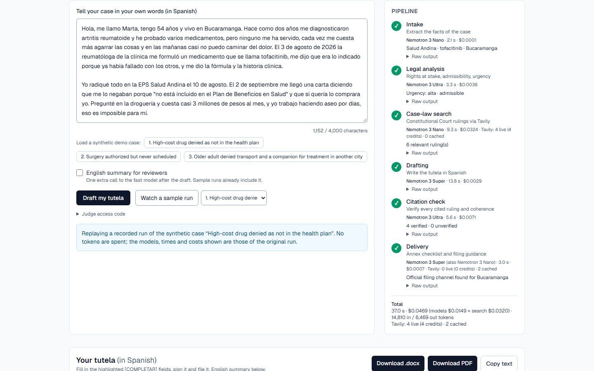
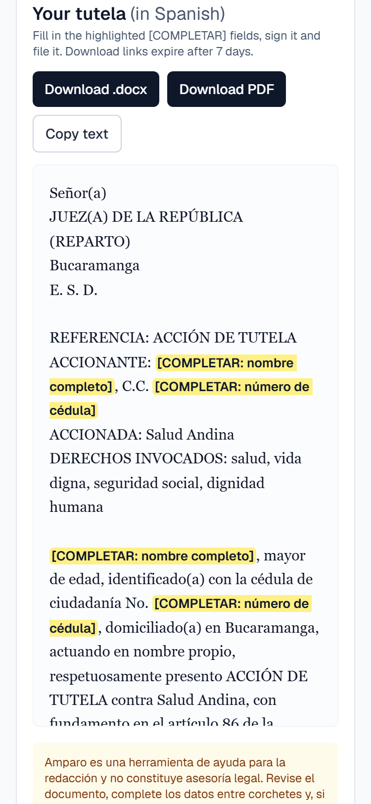
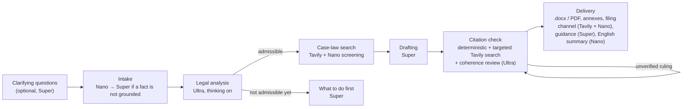
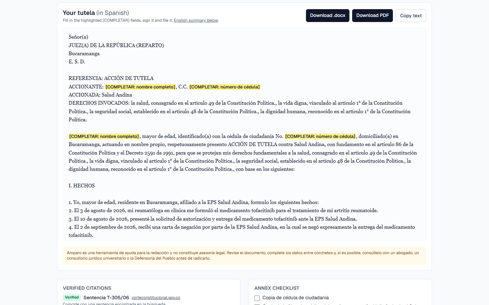
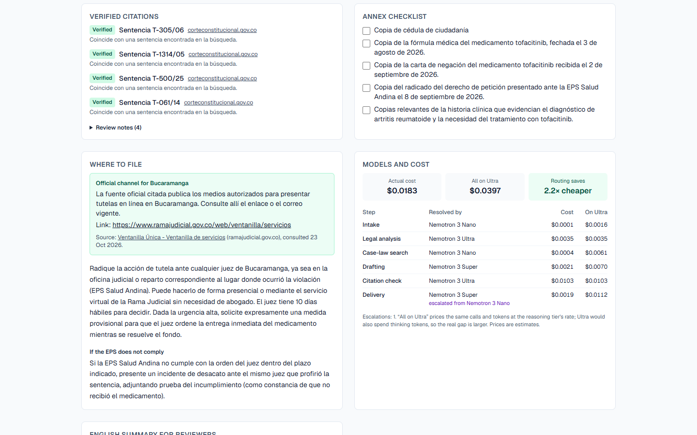
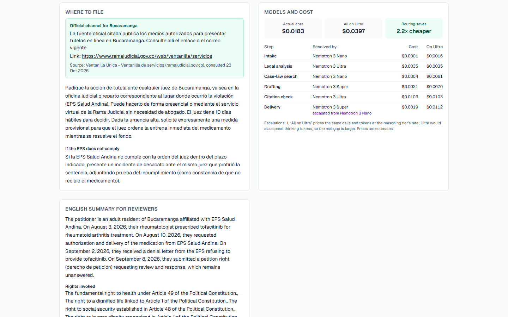
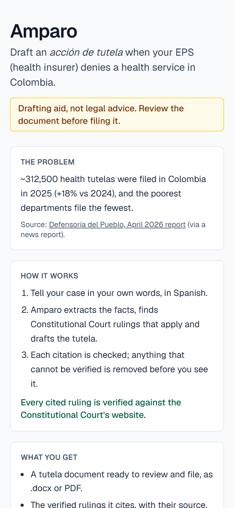
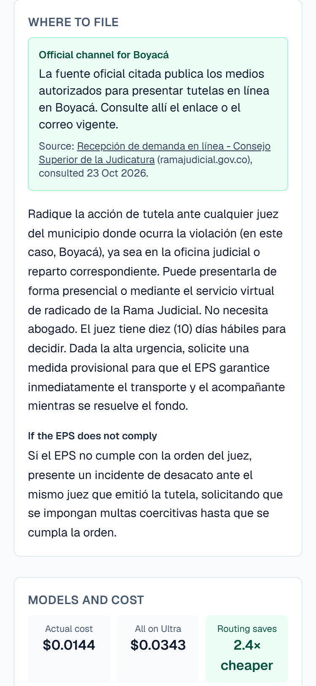
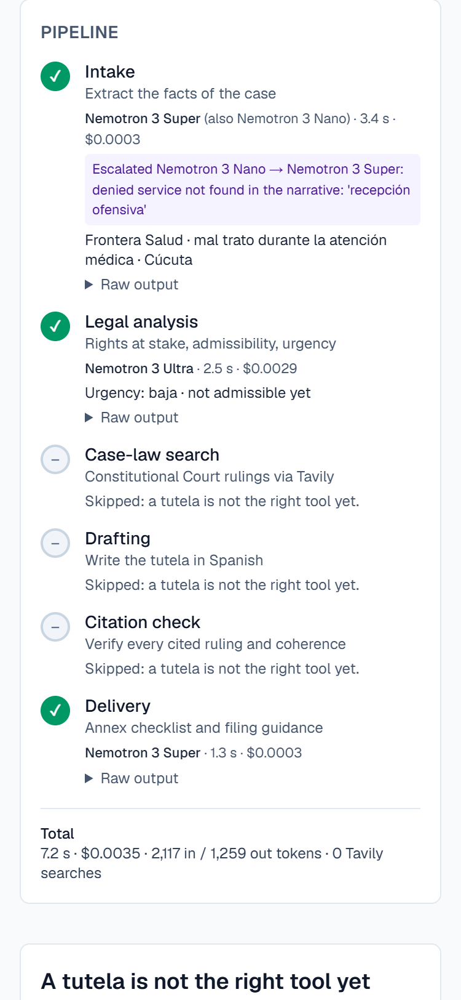
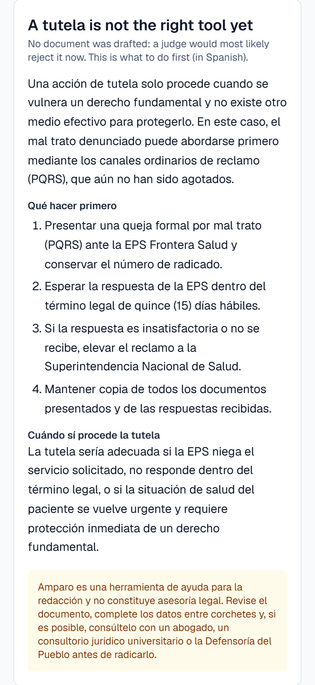

# Amparo

Amparo helps a person in Colombia whose EPS (health insurer) denied a health service draft an *acción de tutela*,
the constitutional action that makes a judge order the service. Tell the story in your own words; get a tutela in the
format a judge expects, with every cited ruling verified against the Constitutional Court's website.

- **Live demo:** https://amparo-swart.vercel.app (or watch a recorded run: [`?sample=1`](https://amparo-swart.vercel.app/?sample=1))
- **Demo video:** _coming soon_
- **For judges:** [docs/TESTING.md](docs/TESTING.md) · **Evaluation:** [docs/EVALUATION.md](docs/EVALUATION.md) · **Feedback for Nebius, NVIDIA and Tavily:** [docs/FEEDBACK.md](docs/FEEDBACK.md) ([summary](docs/FEEDBACK_SUMMARY.md))

> Amparo is a drafting aid, not legal advice.

<p>
  
  
</p>

## The problem

About **312,500 health tutelas** were filed in Colombia in 2025, **18% more** than in 2024; they are **34% of all
tutelas** filed in the country. The poorest departments (Vichada, La Guajira, Chocó) file the fewest, which reflects
harder access to health care and to justice, not better service. Source: Defensoría del Pueblo, April 2026 report, as
reported by [Infobae (23 April 2026)](https://www.infobae.com/colombia/2026/04/23/defensoria-del-pueblo-reporto-incremento-de-18-en-tutelas-para-acceder-a-la-salud-llamo-a-una-reforma-urgente/).

A tutela needs no lawyer, but writing one that cites the right rulings is hard for the people who need it most.

## How it works



1. **Clarifying questions** (optional): if the story misses something critical (the EPS, what was denied, a
   prescription, a contradiction), up to 3 short questions; each can be skipped.
2. **Intake** extracts the facts with Nemotron Nano. Deterministic checks escalate to Super when the EPS, a date or
   the denied service is not in the story; an invented city or condition is set to null without a model call.
3. **Legal analysis** (Ultra): rights at stake, admissibility, urgency and search queries. A tutela that would be
   rejected (the EPS was never asked, no service was denied, nothing concrete to ask) is not drafted: the person gets
   the step to take first instead.
4. **Case-law search**: Constitutional Court rulings via Tavily, screened for relevance by Nano.
5. **Drafting** (Super): the tutela in Spanish, citing only the rulings found, with `[COMPLETAR]` fields for
   personal data.
6. **Citation check**: every citation is checked against the sources; a missing one gets a targeted search, or its
   paragraph is rewritten without it. No unverified citation reaches the document.
7. **Delivery**: the document as .docx and PDF (direct download links), annex checklist, filing guidance and the
   official online filing channel for the person's city, plus an optional English summary for reviewers.

<p>
  
  
</p>

## How we use NVIDIA Nemotron on Nebius Token Factory

All model calls go to Nebius Token Factory through one OpenAI-compatible client (`backend/app/llm.py`). Model IDs
are configuration (`MODEL_FAST`, `MODEL_DRAFT`, `MODEL_REASONING`, `MODEL_FALLBACK`); code selects by tier.

- **Routing by tier.** Each step uses the cheapest model that does it well: Nemotron 3 Nano for extraction and
  screening, Super for the legal text the person reads, Ultra only for the legal analysis and the coherence review.
  Steps moved up a tier only when evaluation showed Nano failing at them (filing guidance, clarifying questions).
- **Thinking per tier.** Reasoning is on for Ultra and off for Nano and Super (`chat_template_kwargs.enable_thinking`),
  which keeps the fast tiers fast and stops Nano from spending its output budget on thinking.
- **Escalation by confidence.** A cheap model's output is checked deterministically before it is used: facts must
  appear in the story (exact for names and dates, approximate for descriptions), the English summary must match the
  draft, and truncated or invalid output counts as a failure. A failed check re-runs that call on Super, and the UI
  shows the escalation and its reason.
- **Structured output.** Every step returns JSON against a strict schema (every field required, no extra fields),
  validated with Pydantic, with one retry that feeds the validation error back.
- **Model fallback.** If a tier's model returns 404 or reports deprecation, the call is retried on `MODEL_FALLBACK`.
- **Measured (models only).** On the [13-case evaluation](docs/EVALUATION.md), the model calls of a drafted tutela
  cost **$0.0145** on average against **$0.0284** with every call on Ultra (**2.0× cheaper**), a lower bound since
  Ultra would also spend thinking tokens. This comparison covers the models only: the Tavily searches cost the same
  whichever model runs. **3 of 13 cases** (23%) escalated a call; a drafted tutela takes 44 s at p50 and 50 s at p95.
  Each step's model and cost are shown in the UI.
- **Whole case (models + Tavily).** A drafted tutela costs **$0.057** cold ($0.0145 models + $0.0427 Tavily,
  5.3 credits) and **$0.046** when the same story runs again with the search cache, down from $0.102 when every
  search was advanced and uncached. Details: [docs/COSTS.md](docs/COSTS.md).



## How we use Tavily

- **Case-law search.** Ultra writes 2 to 4 queries; Tavily runs them in parallel on `corteconstitucional.gov.co`.
  The ruling ID comes from the URL, and each ruling page is downloaded to restore the accents Tavily drops.
- **Verification loop.** A citation that is not among the rulings found gets a targeted search
  (`sentencia T-760/08 relatoria`); if the ruling is found it joins the sources, otherwise its paragraph is rewritten
  without it (up to 2 iterations, then removed deterministically).
- **Filing channel by city.** Two searches restricted to `.gov.co` and the Rama Judicial find the official online
  filing channel for the person's city; regional pages for other cities are filtered out, and a link or e-mail is
  shown only if it appears in the source, with the source and the date of the search.
- **Depth by use.** Every search is basic (1 credit): on the demo cases, basic found as many relevant rulings as
  advanced for the main search, at half the credits ([comparison](docs/COSTS.md#basic-vs-advanced-for-the-main-search)).
- **Cache.** Results are cached for 7 days (Firestore) by normalized query and parameters; a cache hit costs no
  credits, and the UI shows how many searches were live and how many came from the cache.
- **Budget and degradation.** At most 10 searches per case and a daily credit cap (100 public, 150 for judges). If
  Tavily is out of credits or keeps failing, the case stops before drafting and the UI offers a sample run: Amparo
  never drafts a tutela without verified case law.

## Trust and safety

- **Zero unverified citations** in the final document: in the evaluation, 0 across 9 drafted tutelas.
- **Not legal advice.** The UI and the document say so; personal data is left as `[COMPLETAR]` fields to fill in.
- **No tutela when it would fail.** If the case is not admissible yet, Amparo explains why and what to do first.
- **Synthetic data only** in demos, samples and evaluation; finished files are kept for 7 days under an unguessable
  link, and client IPs are stored only as keyed hashes.
- **Usage limits** protect the demo: per-IP and daily limits, a spending cap and a kill switch; judges get their own
  allowance with an access code.
- The Constitutional Court's ruling T-323 de 2024 set criteria for judges' use of AI when deciding tutelas. Amparo
  follows the same spirit of transparency and human review (it shows which model did what and leaves every decision
  to the person and the judge), without claiming that the ruling endorses it.

<p>
  
  
  
  
</p>

## Quickstart

```bash
cp .env.example .env          # add NEBIUS_API_KEY and TAVILY_API_KEY
cd backend && uv sync && cd ..
uv run --project backend python scripts/smoke_test.py          # check APIs and model IDs
uv run --project backend python scripts/run_case.py --all      # run the 3 synthetic demo cases
uv run --project backend python scripts/evaluate.py            # 13 cases -> docs/EVALUATION.md

# API on :8000 (POST /api/cases/intake, POST /api/cases/run as Server-Sent Events,
# GET /api/documents/<id>/<file>, GET /api/usage)
uv run --project backend --directory backend uvicorn app.main:app --reload

# Web UI on :3000
cd frontend && cp .env.example .env.local && npm install && npm run dev
```

## Deploy

The API runs on Google Cloud Run (secrets in Secret Manager, usage counters in Firestore, finished documents in a
Cloud Storage bucket that deletes them after 7 days); the web UI runs on Vercel. Exact commands, limits and the
kill switch: [docs/DEPLOY.md](docs/DEPLOY.md).

## Built with

NVIDIA Nemotron 3 (Nano, Super, Ultra) on Nebius Token Factory, Tavily, FastAPI, Next.js.

Built by Luis Castelblanco. Developed with Claude Code as an AI coding assistant; product, architecture decisions and
validation by the author.

## License

Apache 2.0. See [LICENSE](LICENSE).
